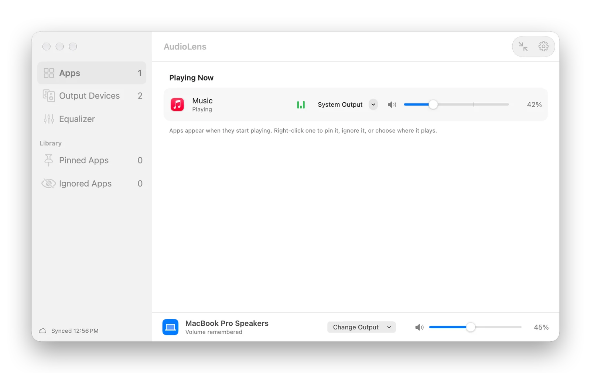
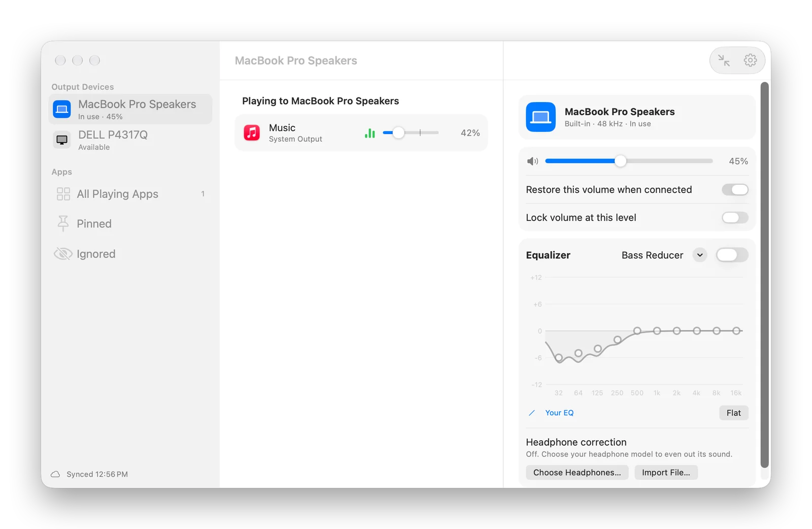
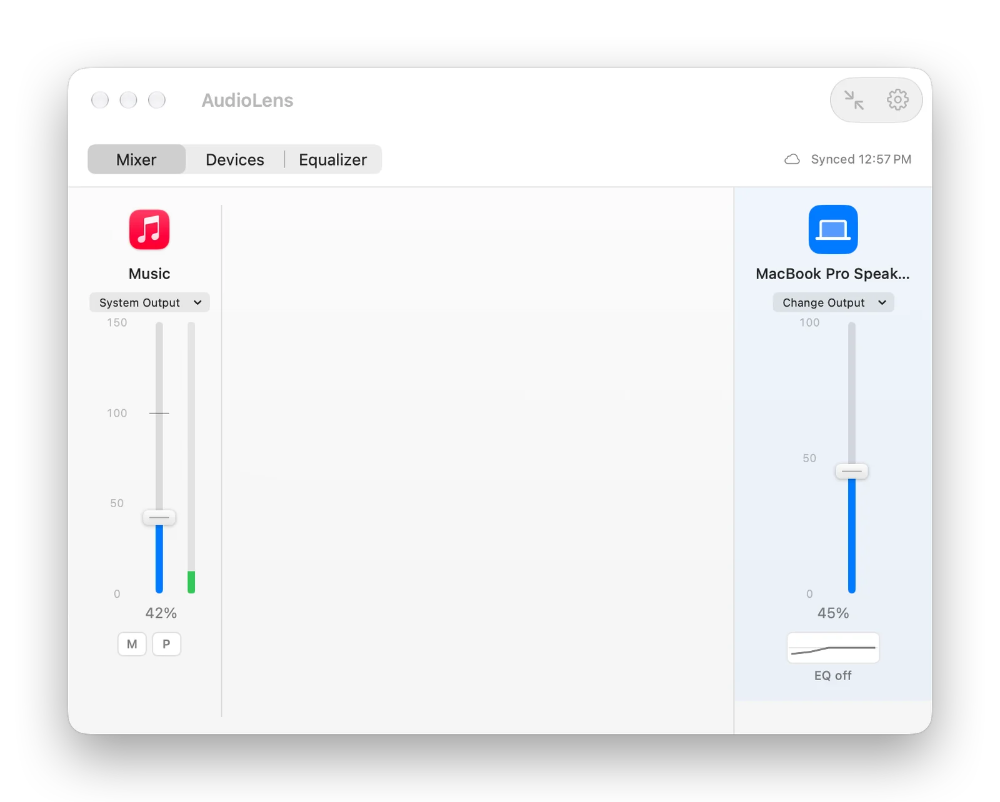
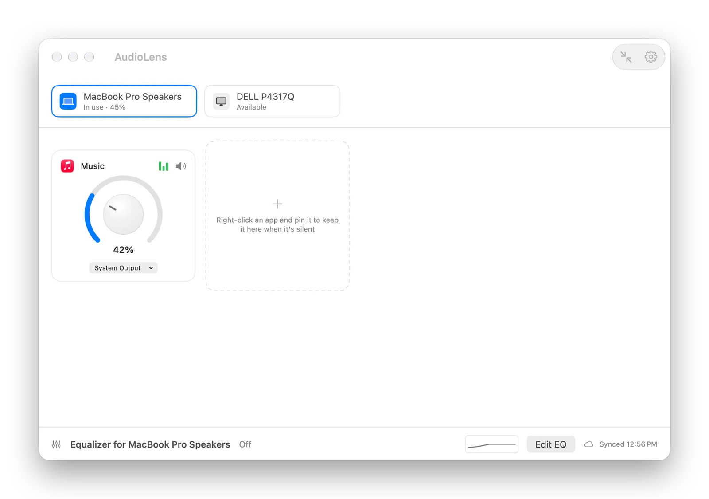
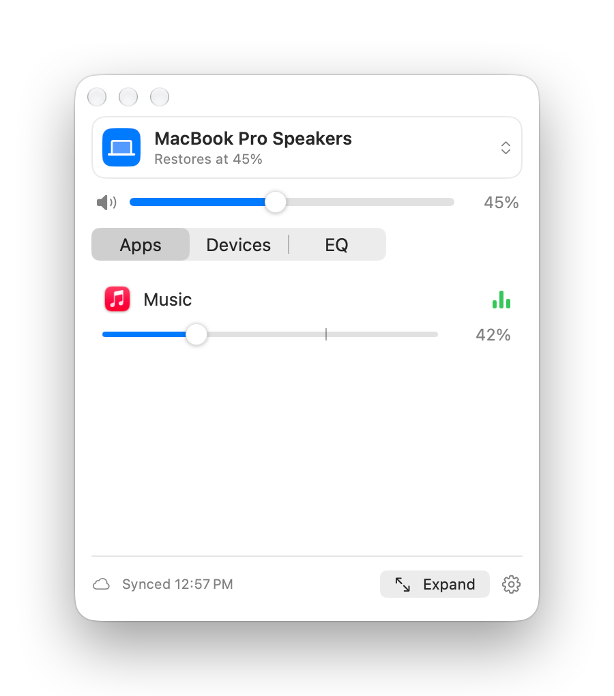

# AudioLens

**Set each app's volume separately from your Mac's volume, and give every output device its own remembered volume and EQ.**

macOS has one volume for everything. A video call ends up as loud as the music behind it, a notification blasts through your headphones, and switching from AirPods to a HomePod leaves you hunting for the right level again. AudioLens gives every app that's playing its own slider (up to 150%), sends any app to the speaker or headphones you choose, and remembers each device's volume and EQ so they come back the moment it connects.

<p align="center"></p>

## Download

### [⬇︎ Download AudioLens.dmg](https://github.com/smanke-org/AudioLens/releases/latest/download/AudioLens.dmg)

1. Open the downloaded **AudioLens.dmg**.
2. Drag **AudioLens** onto the **Applications** folder.
3. Open AudioLens from Applications. The first time you change an app's volume, macOS asks for **System Audio Recording** permission; allow it.

Requires macOS 26 or later.

## What it does

- **Per-app volume.** Every app that's playing gets a slider, from silent to 150%. A soft limiter keeps boosted audio from distorting. Volumes are remembered across restarts.
- **No jump when it quits.** AudioLens keeps your Mac's own volume at the level of the loudest app it's adjusting and turns quieter apps down from there. If AudioLens quits or crashes, the loudest app keeps its level and the others rise only to it, never to full volume. (Settings › General, on by default.)
- **Per-app output.** Send an app to a different device than the system output, for example a call to your AirPods while music plays on the speakers.
- **Device memory.** Each output device (speakers, headphones, AirPods, HomePods, displays) keeps its own volume on each Mac. When it becomes the output again, AudioLens puts the volume back. Lock a device to keep it at that level.
- **Equalizer per device.** A 10-band EQ with presets for each output device, plus **headphone correction**: pick your headphone model from thousands of measurements in the [AutoEQ](https://github.com/jaakkopasanen/AutoEq) project, or import a ParametricEQ.txt file.
- **Recent apps.** Apps that played before stay in a Recent list until you remove them, so you can set their volume or output before they play again.
- **Pin and ignore.** Pin an app to keep it listed while it's silent. Ignore an app and AudioLens leaves it completely alone.
- **Several outputs at once.** Play on the Mac's speakers and an AirPlay HomePod (or any outputs) together. AudioLens holds the faster outputs back to match AirPlay's delay, with a sync slider to fine-tune. Several HomePods join together through Control Center as one AirPlay output.
- **AirPlay.** HomePods, Apple TVs and other AirPlay speakers on your network are listed with a Connect button. macOS only lets its own Sound settings connect them, so Connect opens Sound settings and shows which speaker to click. Once connected, a speaker is an ordinary output with its own remembered volume and EQ.
- **Global hotkeys.** Turn the playing app up or down, or mute it, from anywhere (⌃⌥↑, ⌃⌥↓, ⌃⌥M by default). They also show up in ShortcutsLens.
- **Choose your layout.** Source List (the default), Mixing Desk, Dial Board or Device Inspector, from Settings or the View menu (⌘1 to ⌘4). Any of them shrinks to the compact panel with ⇧⌘C, and the menu bar icon opens the same compact panel.
- **Dock, menu bar, both or neither.** Turn either icon off in Settings. With both off, open AudioLens again from Applications or Spotlight to get the window back.
- **Encrypted sync.** Turn on sync to keep app volumes, device EQ and options the same on all your Macs through iCloud Drive, end-to-end encrypted with your own passphrase. Device volumes and the window layout stay per Mac.

## Screenshots

<table>
<tr>
<td width="50%"><br><sub><b>Device Inspector.</b> Each device's volume, lock and EQ, plus headphone correction.</sub></td>
<td width="50%"><br><sub><b>Mixing Desk.</b> A fader for every app, up to 150%.</sub></td>
</tr>
<tr>
<td width="50%"><br><sub><b>Dial Board.</b> A dial for every app, with the outputs along the top.</sub></td>
<td width="50%" align="center"><br><sub><b>Compact panel.</b> The same controls from the menu bar, or with ⇧⌘C.</sub></td>
</tr>
</table>

## How it works

AudioLens uses Core Audio process taps (macOS 14.4 and later). For an app whose sound needs changing, it captures the app's audio, mutes the original, applies the volume, EQ and limiter, and plays the result on the right device. Apps at 100% on the system output with no EQ are left untouched, so AudioLens costs nothing until you use it. Nothing is recorded or sent anywhere; the sound only passes through on your Mac.

When AudioLens quits, every app goes straight back to normal macOS output, at the level the Mac's own volume was carrying.

## Updates

AudioLens checks GitHub for new versions once a day (you can change how often, or turn it off, in Settings › Updates). It can ask first or install automatically. Automatic installs wait until no adjusted app is playing and your Mac is idle, and every download must be signed by the same developer and notarized by Apple before it's installed.

The update window shows the notes for the latest releases, with the ones you don't have yet marked New, and What's New… in Settings › Updates shows them any time.

## Automation

- `audiolens://show` opens the window, `audiolens://compact` the compact panel, `audiolens://settings` Settings.
- `audiolens://volume-up`, `audiolens://volume-down` and `audiolens://mute` turn the playing app up, down, or mute and unmute it, as the hotkeys do.
- `audiolens://next-output` makes the next output device (in name order, skipping virtual devices) the system output.
- `audiolens://volume?app=<bundle id>&value=<0–150>`, `audiolens://mute?app=<bundle id>&on=<1|0>` and `audiolens://eq?device=default&preset=<name>` set one app's volume or mute, or a device's EQ. `app=playing`, or no `app`, means the playing app.

### Command line and AI agents

AudioLens is also a command line tool, so scripts and AI agents (Claude Code, Codex) can list the apps playing and your output devices, and set an app's volume, mute or output, a device's volume and EQ, the system output, several outputs at once and multi-room AirPlay. Commands run in the open app, and the window shows each change at once. Link it once to type `audiolens`:

```bash
ln -s /Applications/AudioLens.app/Contents/MacOS/AudioLens ~/.local/bin/audiolens
```

```bash
audiolens help
audiolens apps list --json
audiolens apps set com.example.player --volume 40
audiolens outputs set system --eq-preset "Late Night" --dry-run
```

Every command takes `--json`. Commands that change what you hear take `--dry-run` to show the change first. For MCP apps such as Claude Desktop, the same commands are served by `/Applications/AudioLens.app/Contents/MacOS/AudioLens mcp`:

```bash
claude mcp add --scope user audiolens -- /Applications/AudioLens.app/Contents/MacOS/AudioLens mcp
```

[ToolHUD](https://github.com/smanke-org/ToolHUD) lists AudioLens's ring actions on its own: Open AudioLens, Show Compact Panel, Turn the playing app up, Turn the playing app down, Mute or unmute the playing app, and Switch to the next output. The mute button lights up while the playing app is muted.

## Building

```bash
swift test          # the AudioLensKit tests: EQ math, the audio processor, AutoEQ parsing, links
./build_app.sh      # builds and signs .build/app/AudioLens.app with your Developer ID
./release.sh 1.0.1  # build, notarize, disk image and GitHub release
```

Headphone correction data comes from the AutoEQ project by Jaakko Pasanen (MIT License).

## License

© 2026 Steve Manke. All rights reserved.
